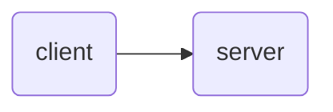
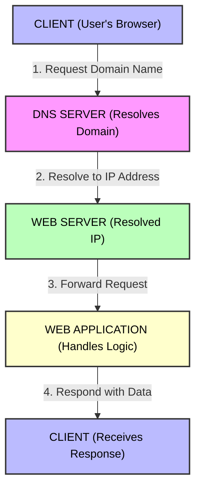

# [System Design for Beginners](https://youtu.be/lFeYU31TnQ8?si=YNKpJpP3uYFnnt88) - By Piyush Garg

---

## **Table of Contents**

- [System Design for Beginners - By Piyush Garg](#system-design-for-beginners---by-piyush-garg)
  - [**Table of Contents**](#table-of-contents)
  - [Introduction](#introduction)
  - [Core Components of System Design](#core-components-of-system-design)
    - [Client \& Server](#client--server)
    - [Domain Name System (DNS)](#domain-name-system-dns)
      - [DNS Resolution Process](#dns-resolution-process)
  - [Scalability \& Fault Tolerance](#scalability--fault-tolerance)
    - [Increase of Users (Clients)](#increase-of-users-clients)
    - [Fault Tolerance of the Server](#fault-tolerance-of-the-server)
    - [Vertical Scaling](#vertical-scaling)
    - [Horizontal Scaling](#horizontal-scaling)
      - [Problem with Horizontal Scaling](#problem-with-horizontal-scaling)
      - [Solution: Load Balancer](#solution-load-balancer)
  - [Load Balancing](#load-balancing)
  - [Microservice Architecture](#microservice-architecture)
  - [API Gateway](#api-gateway)
  - [Communication Between Microservices](#communication-between-microservices)
    - [Queue Systems (SQS)](#queue-systems-sqs)
    - [Publish/Subscribe Systems (SNS)](#publishsubscribe-systems-sns)
    - [Fan-Out Architecture](#fan-out-architecture)
  - [Rate Limiting](#rate-limiting)
  - [Databases \& Replication](#databases--replication)
  - [Caching](#caching)
  - [Content Delivery Network (CDN)](#content-delivery-network-cdn)
  - [Anycast Networking](#anycast-networking)

---

## Introduction

A real-world story from Amazon illustrates the importance of traffic management in system design.

At a high level, there are two main entities:
1. **Client:** The user accessing the application (mobile device, laptop, etc.).
2. **Server:** The machine running the application (typically 24/7).

---

## Core Components of System Design

### Client & Server

- **Server has a Public IP Address.**
- Cloud is essentially another person's computer; hosting in the cloud is optional.
- Clients connect to servers using their public IP address.
- Without a public IP address, a user cannot reach the server.

---

### Domain Name System (DNS)

- The global directory of the Internet.
- Translates domain names to IP addresses—essentially acts as a key-value pair mapping.
- Links domain names with IP addresses.

#### DNS Resolution Process

- The client requests DNS for the IP address of a domain name.
- DNS looks up the domain and returns its IP address.
- The client uses the IP address to connect to the server.

- DNS works in a decentralized manner.

---

## Scalability & Fault Tolerance

### Increase of Users (Clients)

- Servers are machines with limited resources (CPU, RAM).
- As users increase, the server may become overloaded and crash.
- Example: If a college website can handle 500 students but 1000 students access it simultaneously, the server may crash.

---

### Fault Tolerance of the Server

- Frequent server crashes are undesirable.
- Upgrading server resources is called **Vertical Scaling** (adding more CPU, RAM, storage).
- **Down Time Issue:** Upgrading requires restarting the machine, causing downtime.
- Over-optimization: Sometimes resources are wasted when not required.

---

### Vertical Scaling

- Increases resources on an existing server.
- Causes downtime during upgrades.
- Not suitable for handling sudden spikes in traffic.

---

### Horizontal Scaling

- Adds more servers to distribute load.
- Zero downtime—traffic can be routed to other servers if one fails.
- Each server has a different IP address.

#### Problem with Horizontal Scaling

- DNS may route traffic to a server that is overloaded or down.
- Traffic distribution and management become challenging.

#### Solution: Load Balancer

- Add a load balancer between DNS and servers.
- The load balancer has a public IP address and distributes traffic among servers.
- Monitors server health and routes traffic only to healthy servers.

---

## Load Balancing

- Load balancers use algorithms (e.g., Round Robin) to distribute requests.
- **Round Robin:** First request to Server 1, second to Server 2, etc. Then repeats.
- New servers must be registered with the load balancer.
- In AWS, load balancers are called **ELB (Elastic Load Balancer)**.
- Load balancers can crash, but micro-threads/workers help manage failures.

> **Tip:**  
> Use a load balancer in horizontal scaling for efficient traffic distribution.
> In vertical scaling, a load balancer is unnecessary.

---

## Microservice Architecture

- A system divided into specific services:
    1. Authentication Service
    2. Order Service
    3. Payment Service
    4. API Service
    5. Product Service
    - etc.

- URLs are routed to appropriate services:
    - `/api` → API Service
    - `/orders` → Order Service
    - `/payments` → Payment Service
    - `/products` → Product Service

- **API Gateway** is used for routing requests to the correct service.

---

## API Gateway

- Routes requests to appropriate microservices.
- Example:
    - `/auth` → Authentication Service (via Load Balancer)
    - `/orders` → Order Service (via Load Balancer)
    - etc.
- API Gateway has its own public IP (used by DNS).
- Can add authentication (e.g., OAuth).
- Runs background workers for tasks (e.g., sending confirmation emails).
- EC2 (Elastic Compute Cloud) instances act as virtual machines for services.

---

## Communication Between Microservices

### Queue Systems (SQS)

- Communication between microservices (e.g., payment service and email worker) often uses queues.
- **Amazon SQS (Simple Queue Service):** Used for message queuing.
    - **Push:** Send messages to workers.
    - **Poll:** Workers request messages from the queue.
        - **Short Poll:** Frequent checks (higher API calls).
        - **Long Poll:** Less frequent checks (lower API calls).

---

### Publish/Subscribe Systems (SNS)

- For one-to-many communication.
- **Amazon SNS (Simple Notification Service):** Publishes events that multiple microservices can listen for.
- SQS is for one-to-one communication; SNS handles one-to-many.
- **Event-Driven Architecture:** Events trigger actions across microservices.
- Drawback: No native acknowledgement in SNS (must be built).

---

### Fan-Out Architecture

- Events trigger multiple actions.
- SNS sends events to multiple microservices via SQS, which then interact with EC2 instances.
- SQS provides acknowledgement and retry mechanisms.

---

## Rate Limiting

- Protects against DoS and DDoS attacks.
- Limits requests per second (e.g., 5 requests/sec).
- Load balancer can handle incoming requests and forward them to servers at a controlled rate.

**Rate Limiting Strategies:**
1. Leaky Bucket Algorithm
2. Token Bucket Algorithm

---

## Databases & Replication

- Databases store service data.
- **Read Replicas:** Used for analytical processes and logs to prevent overloading the primary database.
- Primary database handles inserts and queries.

---

## Caching

- Reduces load on databases by storing frequently accessed data.
- Improves system robustness and performance.

---

## Content Delivery Network (CDN)

- CDN sits in front of the load balancer, hiding it from direct exposure.
- In AWS, CDN is called **CloudFront**.
- CloudFront deploys machines globally, routing requests to the nearest instance.
- Requests are internally routed to load balancers.

---

## Anycast Networking

- Assigns a single IP address to multiple machines in CloudFront.
- Enhances global accessibility and redundancy.

---
