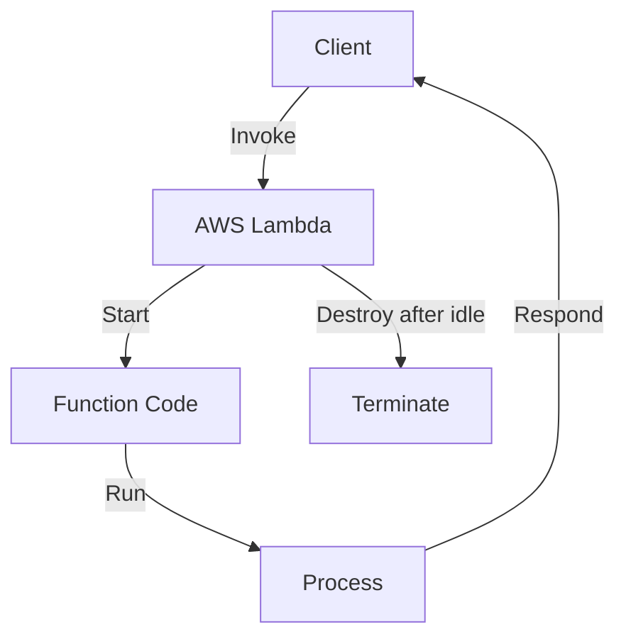

# System Design for Beginners – Summary
Based on [System Design for Beginners](https://www.youtube.com/watch?v=YuB3OuF3MUE) by Piyush Garg

## Table of Contents
- [System Design for Beginners – Summary](#system-design-for-beginners--summary)
  - [Table of Contents](#table-of-contents)
  - [Lambda Servers](#lambda-servers)
  - [Traffic Pattern](#traffic-pattern)
    - [Solution for Netflix Spike:](#solution-for-netflix-spike)
    - [YouTube Spike:](#youtube-spike)
      - [Solutions for YouTube Spike:](#solutions-for-youtube-spike)
    - [Hotstar Spike:](#hotstar-spike)
      - [Solution for Hotstar Spike (Auto Scaling):](#solution-for-hotstar-spike-auto-scaling)
  - [Serverless Architecture](#serverless-architecture)
    - [Downsides of Lambdas](#downsides-of-lambdas)
    - [Pros of Lambda](#pros-of-lambda)
    - [Cons of Lambda](#cons-of-lambda)
  - [Serverful Architecture](#serverful-architecture)
  - [Solution: Virtualization](#solution-virtualization)
  - [Containerization](#containerization)
      - [Problem with Containers](#problem-with-containers)
      - [Solution](#solution)
  - [Deployment Strategies](#deployment-strategies)
  - [Kubernetes](#kubernetes)
  - [Docker Containerization](#docker-containerization)
  - [Solving Scalability Problems with Containerization](#solving-scalability-problems-with-containerization)
  - [Why Kubernetes Is So Popular Nowadays](#why-kubernetes-is-so-popular-nowadays)
  - [Summary](#summary)

---

## Lambda Servers

- Every company has its own use case, USP (Unique Service Pattern), and traffic pattern.
- System Design is not just about studying and implementing; it evolves over time.
- **End goal:** Make the system fully scalable, fault-tolerant, and cost-optimized.
- Every company should understand its traffic pattern.
- For example, Hotstar, Netflix, and YouTube are all video streaming platforms, but they have different USPs and traffic patterns.

---

## Traffic Pattern

- **Burst Traffic:** Sudden spike in user requests.
- Set **policies** for horizontal & vertical scaling:
    - E.g., If the website gets more than 1000 requests in 15 minutes, add another server (Horizontal Scaling).
    - E.g., If CPU utilization averages 70%, add a server (Horizontal Scaling) or increase resources in the existing server (Vertical Scaling).
- Handling spikes (sudden traffic increases) is challenging.

### Solution for Netflix Spike:
- Predict spikes before new releases.
- Netflix releases content (not live), so spikes can be anticipated.
- **Prescale:** Predict spikes 24 hours in advance and prepare servers for upscaling.

### YouTube Spike:
- Spikes are mostly unpredictable, sometimes can be predicted.
- Live streaming is done by individuals, not the company.

#### Solutions for YouTube Spike:
1. Pre-warm servers beforehand.
2. Predict spikes based on historical data.

### Hotstar Spike:
- Hotstar offers both live streaming and movie streaming.
- Spikes are sometimes predictable (e.g., during live games).
- Traffic fluctuates during live events.

#### Solution for Hotstar Spike (Auto Scaling):
- Predict large spikes (e.g., cricket matches, movie releases) and warm up servers in advance.
- Reduce servers for less active services during spikes.
- During live events, keep servers at max level (disable auto-scaling) for fault tolerance.
- Traffic drops in one service can cause spikes in another.

---

- Companies must understand their website’s traffic patterns and scale up/down accordingly.
- Managing servers is overhead: RAM, CPU, disk space, IP allocation, registering with load balancers.

---

## Serverless Architecture

- Serverless means not managing server infrastructure (OS, RAM, CPU, disk, IP, load balancer).
- Lambda is a serverless computing service—you just provide the code.
- Lambda returns a URL; when invoked, AWS Lambda runs your code.
- AWS Lambda automatically scales up and down based on traffic.
- Lambdas are lightweight functions.

- **Serverless Architecture:** All server management, scaling, and configuration are handled by AWS Lambda.

### Downsides of Lambdas

- **Cold Start:** If unused for 2+ hours, first request takes longer to start.
- Continuous traffic prevents lambdas from stopping.

### Pros of Lambda

1. Very cheap.
2. No worries about server configuration or scaling.
3. No server overload or crashes during traffic spikes—automatic scaling.
4. Pay only for active users, not idle servers.

### Cons of Lambda

1. Cold Start.
2. Fixed duration (e.g., 15 seconds per request).
3. Unlimited scaling can be exploited by DDoS attacks.
4. Vendor Lock-In: Code structured for Lambdas is not possible to migrate to another cloud provider.

- Lambda functions can integrate with SQS, API Gateway, CloudWatch, S3, Route53 within AWS.
- Lambdas are always stateless.

---

## Serverful Architecture

- Adding server replicas isn’t easy due to dependency issues (e.g., OS, libraries like ffmpeg).
- New servers require environment setup scripts—heavy and time-consuming.
- **Traditional problem:** "It works on my machine."
- Need for packaging and compatibility.

---

## Solution: Virtualization

- Create virtual machines with OS and required packages.
- Deploy VMs to servers for compatibility.
- Downside: High resource usage due to multiple operating systems.

---

## Containerization

- Lightweight alternative to virtualization.
- Shares host machine’s kernel, runs directly on hardware.
- Containers are isolated but share the same kernel.
- Only pay for the machines, not for lightweight VMs.
- Code works locally and in containers.

#### Problem with Containers

- **Managing containers** (the “brain”)—no intelligence for scaling up/down automatically.

#### Solution

- Container orchestration (management “brain”).

---

## Deployment Strategies

- **Rolling updates:** Replace old containers with new ones during updates.
- **Blue-Green deployments:** (Not detailed here.)

---

## Kubernetes

- **Borg (by Google):** Container management system for massive deployments.
- Borg was rewritten and became **Kubernetes**, donated to CNCF.
- **Kubernetes:** Manages containers and offers reverse proxy, load balancer, controllers, etc.
- Today, containerization and Kubernetes are standard for scalable, zero-downtime deployments.
- Load Testing & Stress Testing: Send fake traffic to check the system’s ability to handle spikes.

---

## Docker Containerization

- Docker is the most popular tool for containerization, allowing consistent environments and easy deployment across platforms.

---

## Solving Scalability Problems with Containerization

- Containerization enables quick scaling, isolation, and efficient resource usage, addressing traditional server scaling challenges.

---

## Why Kubernetes Is So Popular Nowadays

- Kubernetes offers automated container orchestration, scaling, load balancing, and zero-downtime deployments, making it a modern favorite for distributed system management.

---

## Summary

System design evolves with technology and business needs. Understanding traffic patterns and using scalable, fault-tolerant architectures like serverless (Lambda), containerization, and Kubernetes enables companies to optimize costs and reliability. Managing servers manually is increasingly replaced by automated, intelligent solutions for deployment and scaling.