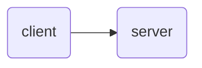
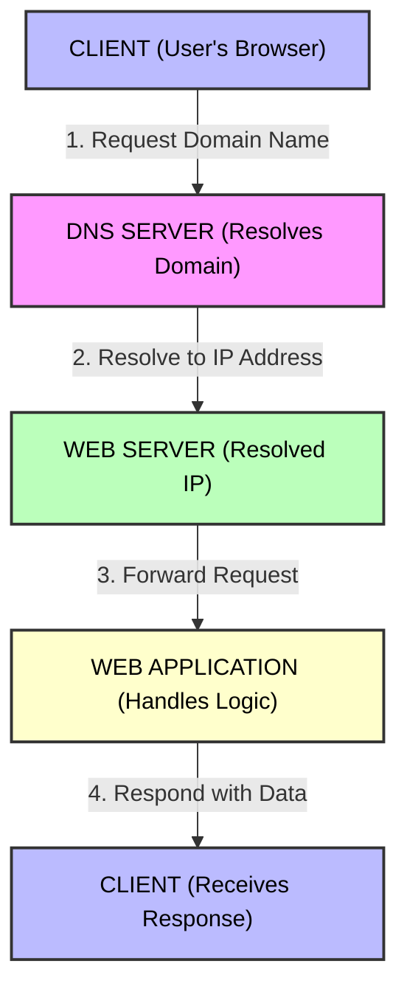

# [System Design for Beginners](https://youtu.be/lFeYU31TnQ8?si=YNKpJpP3uYFnnt88) - By Piysh Garg

## **Table of Content**
- Components of system Design
- In real-time production how the things will work like,  
 - Load Balancer
    - Caching
    - API Gateway
    - Broker System
    - High Throuhput systems

- What is Microsrevice Archicture?
- What is container Orchestrations?
- How are these things are going to work in cloud Environment?
- What are Application Load Balancers?
- What are Network Load Balancers?
- When and How to use Load Balancers?
- What is VPC? (Virtual Private Cloud)
- How many components are there for a System Design?
- How to do Rate Limiting?
- How to do Scale out and Scale In?
- What is Horizantal and Vertical Scaling? And how the scaling is managed?
- What are Auto Scaling Policies?

---

Real-world story on amazon! about Traffic

In system Design at the high level there are two main things:
  1. Client (The person who is using the application it can be any mobile device, laptop or anything.)
  2. Server (It is just a machine Which runs 24/7.)

---

- Server has Public IP Address

1. Is that required to keep the server in the cloud?
- No, Cloud is just a another person's machine.

- Client can request to the server using the Public IP address. 
- Without Public IP address the user can't reach to the server.

---

**component 2:** Domain Name System (DNS) server.
- It is the global Directory of Internet.
- It translates the domain name to the IP address. 
- It links domain name with the IP address.
- It is like a key value pair.

### **DNS Resolution:**
- Client requests the DNS server for the IP address of the domain name.
- DNS server looks up the domain name in its database and returns the IP address to the client.
- Client then uses the IP address to connect to the server.

- DNS works as a decentralized way.

---

### **Increase of the Users (clients)**

- The server is just a Machine that means it has it's own RAM and CPU.

- Suppose if the server has 2 CPU's and 4GB of RAM for one client it's more then sufficient.

- But if the clients increased then the requests count to the server from the users will increase.

- The server will face the problem of scalability (It cannot handle more load).

- Due to less CPU and RAM the server might crash.

- Ex: If a college releases it's results in the website the number of students are more then 1000, but the server can handle only 500 students at one click. If 1000 students clicks at on result button then there might be the server crash.

---

### **Fault Tolerant of the server**

- Server crash everytime is not a good thing.

- first thing is you will upgrade your CPU and RAM by estimating that your website is up everytime.

- But occassionally your website is up and normally you are using limited resources from the server.

- Here we are kind of wasting the resources. (Problem caused: Over Optimization.)

- It is called Vertical Scaling.

- In vertical scaling we are increasing the physical server's resources.

- In short, Vertical Scaling is adding more resources to the existing server.

- eg: Increasing CPU, RAM, Storage.

## Problems of Vertical Scaling:

### Down Time

- We can't use vertical scaling in running machine. 

- The machine should be restarted if you are adding physical resources.

- That means there will be some Down Time.

- If the users suddenly increased. Then there will be problem

- Problem like first the server will be stopping first then the resourses will be increased then it will start.

--- 

**Horzintal Scaling:**

- The load will be on the first server, and if we see the there is more rush then we can start up the other machine or server.

- In short, Horzintal Scaling is adding more servers.

- In Horzintal Scaling we are adding more servers.

- Here the Down time is zero.

- But all the servers have different IP address.

**Problem of Horzintal Scaling:**

- If the user is requesting the DNS for a specific website and the website is horizantally scaled that means:
  
  - The DNS server will get the response from the first server.
  
  - The first server is already full of traffic/ down then it will be the issue.
  
  - Distribution of the traffic is the main problem of Horizantal Sacling.

### **Solution:**

- We should add a middle server connecting to all the replicent servers. (Load Balancer)

- Load Balancer also has it's IP. This load balancer IP address will be the public IP address, which is connected to DNS server.

- Now if the user visits the website then the load balancer will get the request from the user.

- Load balancer will distribute the traffic to all the servers.

- Load balancer will also monitor the servers. If any server is down then it will not send the traffic to that server.

## **Load Balancer**

- Load balancer has many Alogrithms.

- Simpliest Algorithm which is used in the Load Balancer is Round Robin.

    - First request is sent to first server, second request is sent to second server, third is sent to third server, and soo on till request n to nth server. 
    
    - After sending the request to nth server again the next n+1 request will be sent to first server, n+2 request to second server, n+3 request to third server, and soo on.

    - This will distribute the load equally amoung the servers.

- When ever we create a new server we should register that server in the load balancer.

- Then the load balancer will check weather the server is healthy or not.

- In Amazon world this load balancer is termed as ELB (Elastic Load Balancer).

- Some times the load balancer may have chances of crash but the mirco - threads, workers will handle that crash.

### In horizantal scale we should use Load Balancer to balance the traffic and efficient use of all the servers.

### In Vertical scale we don't have to use any load balancer because we are increasing the resources of the existing server itself.

---

## Microservice Archicture:

- In microservice archicture we have so man services:

  1. Authentication Service
  2. Orders
  3. Payments
  4. API
  5. Products
    ....

- If we want our website to work on different servers:

- If the user enters the url like [amazon](https://www.amazon.com/) that should go to API services.

- If the user enters the url like [Amazon orders](https://www.amazon.com/orders) that should go to orders service.

- If the user enters the url like [Amazon payments](https://www.amazon.com/payments) that should go to payments service.

- If the user enters the url like [Amazon products](https://www.amazon.com/products) that should go to products service.

then we need to use **Route Routing/ API Gateway.**

## **API Gateway:**

  - It is /auth then redirect it to Authentication Service.
    
    - /auth => Authentication Service (Load Balancer).

  - It is /orders then redirect it to Orders Service.

    - /orders => Orders Service (Load Balancer).

  - It is /payments then redirect it to Payments Service.

    - /payments => Payments Service (Load Balancer).

  - It is /products then redirect it to Products Service.

    - /products => Products Service (Load Balancer).

- **API Gateway:** It will check on which services it should route.

- **EC2 (Elastic Compute Cloud) Machines:** which will be working as a virtual machines for all the serives.

- EC2 Machines are also known as VM in Amazon terminology.

- API Gateway also has it's own IP.

- Now the DNS will be having this API Gateway IP Instead of the Load Balancer IP. so that, whenever the request is sent by the user it will be pointing to API Gateway. The API Gateway will route to the services (Load Balancer).

- We can add authenticator to an API Gateway (Oauth).

- Workers will be running in the background.

- If the user has paid for an order and the payment services will be internally calling the Email worker to send the payment conformation mail.

- Then the email worker will be interacting with the external Gmail api.

- Whatever the response which the email worker got it from gmail api will be sent back to the payment services by the email worker.

- This method is internal call for the worker and giving the work to him is called **Syncronous way**.

- Here the payment server will have to wait till the mail is sent by the email worker.

- If every second one payment is done then it is **not scalable solution**.

- In this case we can make this **Syncronous to Asyncronous**.

- Instead of the Syncronous way we can setup a communication system (which is asyncronous) in between payments and email worker.

- Mostly used communication system is Queue (FIFO).

- Payment services will push the `order ID` of the payments in the queue whenever the order is placed.

- Email worker will pull the order ID from the queue and will send the mail and then discard them.

### **Use of Queue system**

- To establish the communication between two microservices. 

- For this in amazon we use **SQS (Simple Queue System)**.

- There are two machinisms in this SQS:
  
- In SQS it sends the acknowledgement back to the Queue.

  1. Push (From Queue to Email worker)
  2. Poll (The Email worker is requesting the queue for the order ID)
  
     - **Short poll:** For every second the Email worker will ask the Queue for the order ID. 
         
         - Here in short polling the API calls are getting nincreased because the Email worker is asking the queue for the order ID for every second.

     - **Long poll:** For every 10 seconds the Email worker will ask the Queue for the order ID.
---

- In one event if you want to do 4 things. E.g: On successful payment you want to send the successful payment mail, Contact number, Vendor and also want to store that data in Database.

- In this case you can go by pup sub model. (Publish the model)

- **SNS (Simple Notification Service)**

- In SNS if the notification is sent then miltiple microservices can listen to that.

- E.g: If the payment is done by the user, then the payment will send that to SNS and SNS will be cnnected to all the microservices then all the microservices can listen to that.

- SQS has one to one microservices communication, but SNS has one to many microservices communication.

- **Event Ariven Archicture:** When a event occurs then the publisher will publish the event to SNS and SNS will be connected to all the microservices.

- In Event Driven Archicture we have one drawback that is no acknowledgement is sent to the SNS back. (You have to build the Acknownedgement system).

---

## **Fan out Architecture:**

- When a event is triggered we have to do multiple things not just one thing.

- Here both SNS and SQS will be running.

- The event is sent to the SNS and the SNS will sent it to the microservices these microservices are connected with SQS and at the end they are connected to EC2 (Elastic Compute Cloud).

- The SQS will send the acknowledgement back to the SNS.

- Here we will have retry mechanism and also acknowledgement mechanism.

---

## **Rate Limiting**

- In Load Balancer we will keep rate limiting to prvent it from DoS and DDoS attacks (exploit).

- Rate Limits like 5 requests per second.

- Or we can set the Rate Limiting in such a way that Load Balancer accepts all the requests but we will send to the servers in the controlled way. 

- **Rate Limiting strategies:**

  1. Leaky Bucket Rate Limiting.
  2. Token Bucket Rate Limiting.

---

## **Databases:**

- Databases are used to store the data from all the services.

- If it is completely filled, to maintain this databased we create database replicas.

- These replicas are called as read replicas

- The primary database is used for insert the data and to fetech the data.

- For time taking processes like analytical processes, logs then we can use the read replica databases, by this primary database will not be loaded more.

---

## **Caching**

- If you want to perform some complex compution then use cache.

- Cache is used for to reduce the calls on the database by storing the data into the cache.

- By using all this cache your system will become more robust.

---

## **CDN (Content Delivary Network)**

- It will be infront of the Load Balancer, it will not expose the Load Balancer directly.

- This CDN is called as CloudFront in Amazon's terminology.

- This cloudfront goes to all the regions of the world and deploys a machine.

- All these cloudfront machines are internally routed to the Load Balancers.

- We will be requesting to the nearest cloudfront.

--- 

## **AnyCast**

- A single IP can be assigned to all the machines in the cloudfront. 