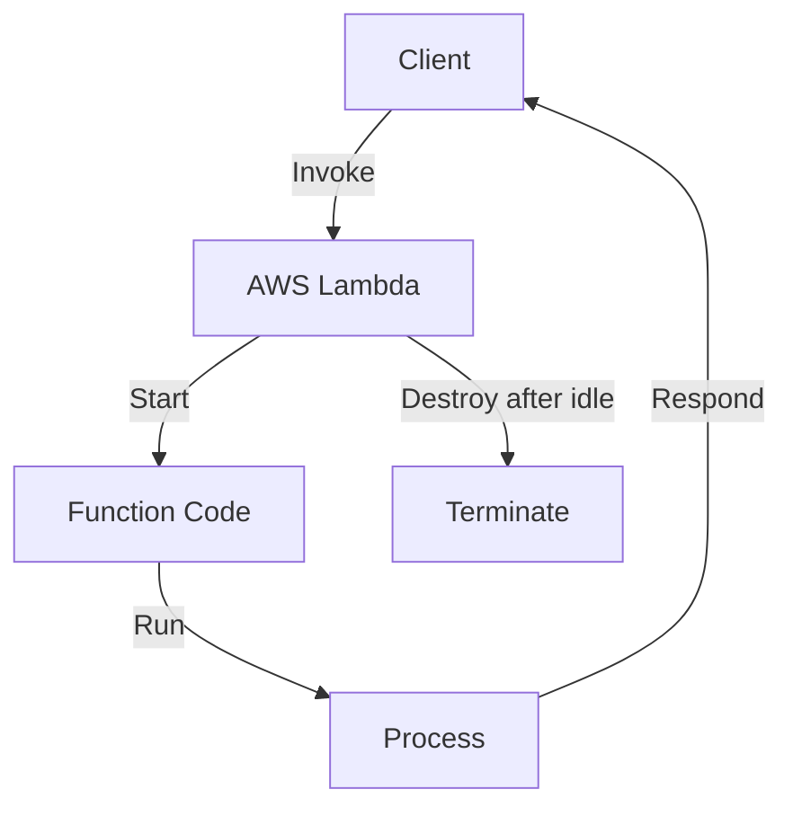

# [System Design for Beginners - Part 2](https://www.youtube.com/watch?v=YuB3OuF3MUE) - By Piysh Garg

## **Table of Content**
- Lambdas Servers
- Serverless Architecture
- Kubernetes
- Docker Containerization
- How to solve the scalability problem using containerizations
- Why kubernetes is so popular now a days?

---

- Every company has it's own use case, it's own USP (Unique Service Pattern), they have there own traffic pattern.

- System Desgin cannot be just studying and doing, System Design is something which evolves over time.

- **End goal:** We want to make our system fully scalable and fault tolerant, Cost optimization.

- Every company should understand their traffic pattern.

- Ex: HotStar, Netflix, YouTube are the video streaming platforms but they have different USP, they have different traffic pattern.

---

## **Traffic Pattern**

- **Brust Traffic:** Sudden hype of the user traffic.

- We should set a **policy** for the horizontal & vertical scaling .

- Policy means we have to tell the machine when it should scale up.

    - Ex: If my website is getting more then 1000 requests in 15 minutes then add another server (Horizantal Scaling).

    - Ex: If my website is getting more then 1000 requests in 15 minutes then increase the resourses in the existing server (Vertical Scaling).

    - If my avarage CPU utilization is around 70% then add one more server (Horizantal Scaling).

    - If my avarage CPU utilization is around 70% then Increase the resouces in the existing server (Vertical Scaling).

- Handling spikes (Sudden increase of the traffic) is very difficult.

## **Soultion for Netlix Spike:**
  
  - We can predict the spike before some new thing is about to launch.

  - Here in case of Netflix the Netflix creators will publish the movie not live casting.
    
  - **Prescale** Before 24 hours we will try to predict the spike and keep the servers ready to upscale when there is a spike.

## **YouTube Spike:**

  - YouTube Spikes cannot be predicted, sometimes it is predicted but not everytime
    
  - We cannot predict the pike in YouTube because, Because of Live Streaming is done by every individual not by the company.

## **Solution for YouTube Spike:**

  - **Possible soultion 1:** We can just pre-warm the server before.

  - **Possible soultion 2:** We can Predict it based on historical data.

## **Hotstar Spike:**

   - Hotstar is both Live streaming as well as Movie streaming platform.
   
   - Hotstar Spikes cannot be predicted, sometimes it is predicted but not everytime.

  - Here, the traffic will be going up and down, because it's live game. 
   
## **Solution for Hotstar Spike (Auto scaling):**

   - If there is a Cricket match next day then the Hotstar can predit that there will be huge spike and warm up there server and keep them ready to handle the sudden spikes.
   
   - On the match day there will be few people who watch movies So, Hotstar can reduce the servers in the movie.
   
   - If there is a movie release then Hotstar can predict that there will be huge spike and keep the servers ready to handle the sudden spikes.

- If the traffic is going up and down just turn off the Auto scaling and just keep the servers at max level till the game ends, Because we need to make our system fault tolerant we need to keep scaling up.

- Every dip in the game spike may cause the spike in the movies services.

---

- The traffic patterns of every website should be understood by the companies and up-scale and down-scale according to the traffic.

---

- Managing the servers is overhead, we should think about how much RAM we should provide, how much CPU we should provide, how much disk space we should provide, IP allocation, Registering the server in load balancer.

---

## **Serverless (Lambda)**

- Serverless means you don't manage the server, the overhead mentioned like deciding the OS, RAM, CPU, disk space, IP allocation, Registering the server in load balancer.

- Lambda is a serverless computing service that allows you to run code without provisioning or managing servers.

- We just have to give the **code** to the lambda.

- Then lambda will give back the URL

- In this lambda we don't know how many CPU's are preset, how much the RAM is provided.

- When the clint click on the URL generated by the lambda, then automatically AWS lambda will run the code which you provided.

- If there is much traffic on the website then the lambda will automatically spin up new lambdas, that means one request for one lambda.

- If the traffic is less then the lambda will automatically spin down the lambdas.

- Lambdas are just simple light wight functions.

- **Serverless Architecture:** Means we will not manage the server, CPU, RAM, Disk Space, auto scaling policy, all this will be taken care by the AWS lambda function.

---

## **Downside of Lambdas**

- **Cold Start:** If the lambda is not called for more then 2 hours then it will take more time to start for the first user, from the next users the start up will be fast.

- If your website has continuous traffic then the lambda will never stop. 

---

## **Pros of Lambda**

1. It is very cheap.

2. No tesnions of server, configuration, scalablity, Auto scaling.

3. In traditional machines (Servers) if there is a traffic spike then the server will get overloaded and will crash, but in lambda the lambda will never get overloaded and will never crash, and the lambda will be automatically scaled up.

4. In traditional machines you have to pay for hour even though there are no users, but in lambda you only pay when there are active users.

## **Cons of Lambda**

1. Cold Start.

2. Fixed duration. (That means here only 15 seconds will be there to return a request)

3. If it is attacked by DDOS then you can run `n` number of lambdas, because scaling will never stop.

4. Vendor Lock-In: If your code is structured based on the Lambdas then you cannot change it from AWS to another cloud platform.

- When you run a Lambda function, services like **SQS, API Gateway, CloudWatch, S3 (Simple Storage Service), and Route53** may be automatically triggered or integrated for various reasons. All of these services are part of the AWS ecosystem, and your Lambda function operates within this environment.

- Lambdas are always stateless
  
- No configurations for Pros and Cons

---

## **Serverfull Architecture:**

- If you want to add the replica of the same machine/server, techniquely it not easy.

- **Reason:** Locally, you are using Windows OS, you wrote the code, but the code will be depeneding on libraries/modules `ffmpeg: It is a CLI tool that helps in transcoding and video maniplication`, you installed ffmpeg on your local machine and your code is working, when you try to deploy it. 

- The next server/machine should also have the tool ffmpeg then only the code will work in that system.

- Whenever you are going to new server, first and formost thing you should run the script to install ffmpeg. (This will take more time).

- Scaling will take time, this process is Heavy process.

- **Traditional problem:** It work on my machine.

- Need of Packages

## **Problems:** heavy process, setting up the environment, compatibility issues.

## **Solution:**

- **Virtualization**

    - In Virtualization, you can create a virtual image/ virtual machine.
    - You can create a VM locally with OS, install the required packages in that VM and then you can deploy it to the server.
    - Now it can work on any machine.

The problem with virtualization is that it uses a lot of resources. This is because you already have one operating system running, and inside that, you’re trying to run another virtual machine with its own operating system.

To solve this we have the concept called **containerization**.

**Containerization:** It is a lightweight alternative to virtualization. It shares the kernel with the host machine, which means it runs directly on the hardware. Containers are isolated from each other, but they can share the same kernel.

- By using this concept, you can create containers, which are isolated from each other, but they can share the same kernel.

- By using this containerization you are just paying for the machines but not for all the light weight VM's 

- The codes will work on the local server as well as the containers.

## **Problem with the containers**

- **Managing the containes** (Brain).

- There’s no intelligence to automatically create new containers when traffic increases or to destroy containers when there’s no traffic.

## **Solution**

- Managing the containers (the “brain”) is known as container orchestration.

## Deployment Strategies

- **Rolling updates:** The containers will automatically delete the previous containers and then update them when there is new version of the code.

- Blue Green deployments.

---

We should create a container orchestrator

- **Borg:** Which is developed by Google to manage the containers which has massive deployment.

- The team that created Borg rewrote the entire project and named it Kubernetes. Kubernetes can manage container deployment, and they made it open source by donating it to the Cloud Native Computing Foundation (CNCF).

- **Kubernetes:** Manages the containers.

- In mordern Development we use Containerization, because it is light weight and fast with zero downtime deployment, also we have Kubernetes as the container orchestrator.

- Kubernetes has it's own reverse proxy, load balancer, controllers and everything.

- From basic deployement to advance Containerization, Kubernetes this is how the System Design has envolved over the time.

- Load Testing & Stress Testing: Sending the fake traffic to our own website to check the website can handle sudden spike.