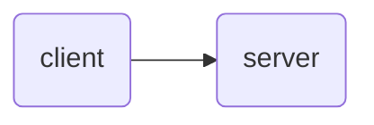
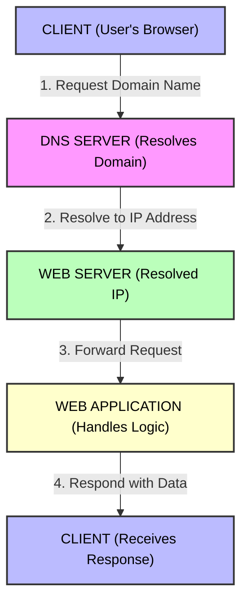
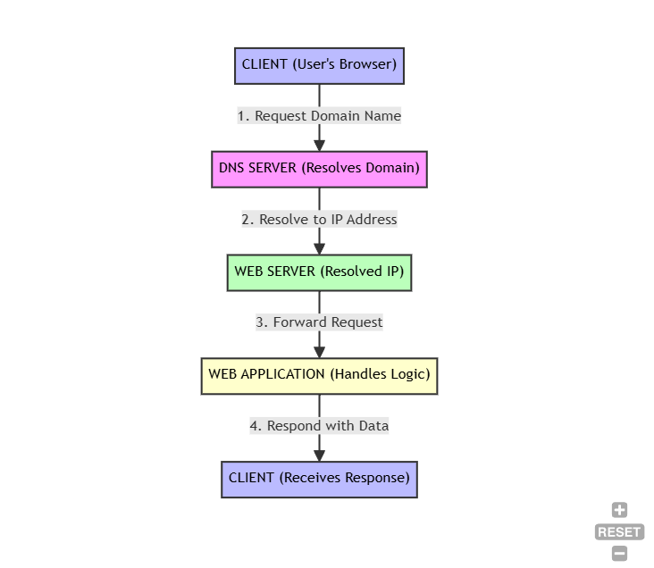
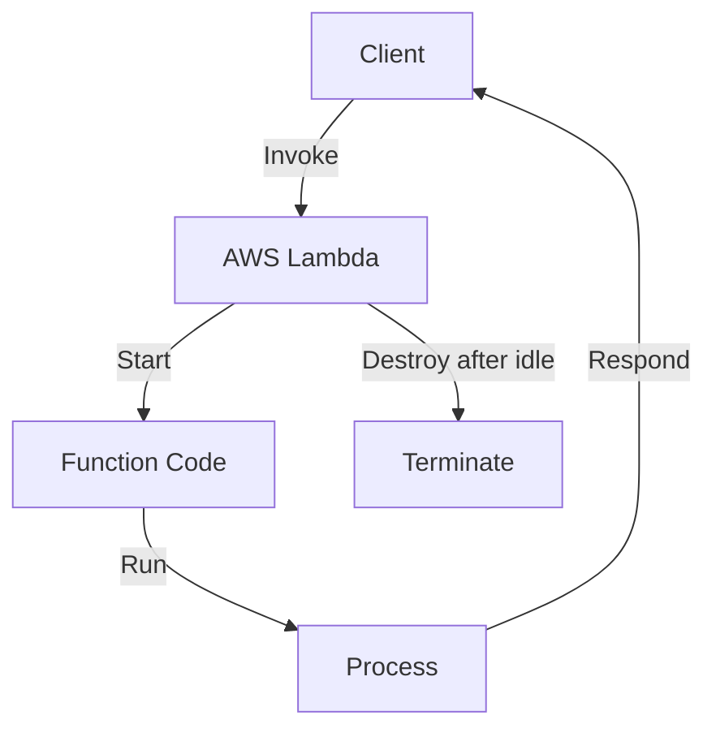

# System Design for Beginners – By Piyush Garg

*Based on: [System Design for Beginners - Part 1](https://youtu.be/lFeYU31TnQ8?si=YNKpJpP3uYFnnt88) and [System Design for Beginners - Part 2](https://www.youtube.com/watch?v=YuB3OuF3MUE)*

---

## Table of Contents

- [System Design for Beginners – By Piyush Garg](#system-design-for-beginners--by-piyush-garg)
  - [Table of Contents](#table-of-contents)
  - [Introduction](#introduction)
  - [Core Components of System Design](#core-components-of-system-design)
    - [Client \& Server](#client--server)
    - [Domain Name System (DNS)](#domain-name-system-dns)
      - [DNS Resolution Process](#dns-resolution-process)
  - [Scalability \& Fault Tolerance](#scalability--fault-tolerance)
    - [Increase of Users (Clients)](#increase-of-users-clients)
    - [Fault Tolerance of the Server](#fault-tolerance-of-the-server)
    - [Vertical Scaling](#vertical-scaling)
    - [Horizontal Scaling](#horizontal-scaling)
      - [Problem with Horizontal Scaling](#problem-with-horizontal-scaling)
      - [Solution: Load Balancer](#solution-load-balancer)
  - [Load Balancing](#load-balancing)
  - [Traffic Patterns](#traffic-patterns)
      - [Solution for Netflix Spike](#solution-for-netflix-spike)
      - [YouTube Spike](#youtube-spike)
        - [Solutions for YouTube Spike](#solutions-for-youtube-spike)
      - [Hotstar Spike](#hotstar-spike)
        - [Solution for Hotstar Spike (Auto Scaling)](#solution-for-hotstar-spike-auto-scaling)
        - [General Scaling Policies](#general-scaling-policies)
  - [Microservice Architecture](#microservice-architecture)
  - [API Gateway](#api-gateway)
  - [Communication Between Microservices](#communication-between-microservices)
    - [Queue Systems (SQS)](#queue-systems-sqs)
    - [Publish/Subscribe Systems (SNS)](#publishsubscribe-systems-sns)
    - [Fan-Out Architecture](#fan-out-architecture)
  - [Rate Limiting](#rate-limiting)
  - [Databases \& Replication](#databases--replication)
  - [Caching](#caching)
  - [Content Delivery Network (CDN)](#content-delivery-network-cdn)
  - [Anycast Networking](#anycast-networking)
  - [Serverless (Lambda)](#serverless-lambda)
    - [Downsides of Lambdas](#downsides-of-lambdas)
    - [Pros of Lambda](#pros-of-lambda)
    - [Cons of Lambda](#cons-of-lambda)
  - [Serverful Architecture, Virtualization \& Containerization](#serverful-architecture-virtualization--containerization)
    - [Solution: Virtualization](#solution-virtualization)
    - [Containerization](#containerization)
      - [Problem with Containers](#problem-with-containers)
      - [Solution](#solution)
    - [Deployment Strategies](#deployment-strategies)
  - [Container Orchestration \& Kubernetes](#container-orchestration--kubernetes)
  - [Summary](#summary)

---

## Introduction

A real-world story from Amazon illustrates the importance of traffic management in system design.

- Two main entities:
  1. **Client:** The user accessing the application (mobile device, laptop, etc.).
  2. **Server:** The machine running the application (typically 24/7).

---

## Core Components of System Design

### Client & Server

- **Server has a Public IP Address.**
- Cloud is essentially another person's computer; hosting in the cloud is optional.
- Clients connect to servers using their public IP address.
- Without a public IP address, a user cannot reach the server.

---

### Domain Name System (DNS)

- The global directory of the Internet.
- Translates domain names to IP addresses—acts as a key-value pair mapping.

#### DNS Resolution Process

- The client requests DNS for the IP address of a domain name.
- DNS looks up the domain and returns its IP address.
- The client uses the IP address to connect to the server.

- DNS works in a decentralized manner.

---

## Scalability & Fault Tolerance

### Increase of Users (Clients)

- Servers are machines with limited resources (CPU, RAM).
- As users increase, the server may become overloaded and crash.
- Example: If a college website can handle 500 students but 1000 students access it simultaneously, the server may crash.

---

### Fault Tolerance of the Server

- Frequent server crashes are undesirable.
- Upgrading server resources is called **Vertical Scaling** (adding more CPU, RAM, storage).
- **Down Time Issue:** Upgrading requires restarting the machine, causing downtime.
- Over-optimization: Sometimes resources are wasted when not required.

---

### Vertical Scaling

- Increases resources on an existing server.
- Causes downtime during upgrades.
- Not suitable for handling sudden spikes in traffic.

---

### Horizontal Scaling

- Adds more servers to distribute load.
- Zero downtime—traffic can be routed to other servers if one fails.
- Each server has a different IP address.

#### Problem with Horizontal Scaling

- DNS may route traffic to a server that is overloaded or down.
- Traffic distribution and management become challenging.

#### Solution: Load Balancer

- Add a load balancer between DNS and servers.
- The load balancer has a public IP address and distributes traffic among servers.
- Monitors server health and routes traffic only to healthy servers.

---

## Load Balancing

- Load balancers use algorithms (e.g., Round Robin) to distribute requests.
- **Round Robin:** First request to Server 1, second to Server 2, etc. Then repeats.
- New servers must be registered with the load balancer.
- In AWS, load balancers are called **ELB (Elastic Load Balancer)**.
- Load balancers can crash, but micro-threads/workers help manage failures.

> **Tip:**  
> Use a load balancer in horizontal scaling for efficient traffic distribution.
> In vertical scaling, a load balancer is unnecessary.

---

## Traffic Patterns

- Every company has its own use case, USP (Unique Service Pattern), and traffic pattern.
- System Design is not just about studying and implementing; it evolves over time.
- **End goal:** Make the system fully scalable, fault-tolerant, and cost-optimized.
- Every company should understand its traffic pattern.
- For example, Hotstar, Netflix, and YouTube are all video streaming platforms, but they have different USPs and traffic patterns.

- **Burst Traffic:** Sudden spike in user requests.
- Set **policies** for horizontal & vertical scaling:
    - E.g., If the website gets more than 1000 requests in 15 minutes, add another server (Horizontal Scaling).
    - E.g., If CPU utilization averages 70%, add a server (Horizontal Scaling) or increase resources in the existing server (Vertical Scaling).
- Handling spikes (sudden traffic increases) is challenging.

#### Solution for Netflix Spike

- Predict spikes before new releases.
- Netflix releases content (not live), so spikes can be anticipated.
- **Prescale:** Predict spikes 24 hours in advance and prepare servers for upscaling.

#### YouTube Spike

- Spikes are mostly unpredictable, sometimes can be predicted.
- Live streaming is done by individuals, not the company.

##### Solutions for YouTube Spike

1. Pre-warm servers beforehand.
2. Predict spikes based on historical data.

#### Hotstar Spike

- Hotstar offers both live streaming and movie streaming.
- Spikes are sometimes predictable (e.g., during live games).
- Traffic fluctuates during live events.

##### Solution for Hotstar Spike (Auto Scaling)

- Predict large spikes (e.g., cricket matches, movie releases) and warm up servers in advance.
- Reduce servers for less active services during spikes.
- During live events, keep servers at max level (disable auto-scaling) for fault tolerance.
- Traffic drops in one service can cause spikes in another.

##### General Scaling Policies

- Companies must understand their website’s traffic patterns and scale up/down accordingly.
- Managing servers is overhead: RAM, CPU, disk space, IP allocation, registering with load balancers.

---

## Microservice Architecture

- A system divided into specific services:
    1. Authentication Service
    2. Order Service
    3. Payment Service
    4. API Service
    5. Product Service
    - etc.

- URLs are routed to appropriate services:
    - `/api` → API Service
    - `/orders` → Order Service
    - `/payments` → Payment Service
    - `/products` → Product Service

- **API Gateway** is used for routing requests to the correct service.

---

## API Gateway

- Routes requests to appropriate microservices.
- Example:
    - `/auth` → Authentication Service (via Load Balancer)
    - `/orders` → Order Service (via Load Balancer)
    - etc.
- API Gateway has its own public IP (used by DNS).
- Can add authentication (e.g., OAuth).
- Runs background workers for tasks (e.g., sending confirmation emails).
- EC2 (Elastic Compute Cloud) instances act as virtual machines for services.

---

## Communication Between Microservices

### Queue Systems (SQS)

- Communication between microservices (e.g., payment service and email worker) often uses queues.
- **Amazon SQS (Simple Queue Service):** Used for message queuing.
    - **Push:** Send messages to workers.
    - **Poll:** Workers request messages from the queue.
        - **Short Poll:** Frequent checks (higher API calls).
        - **Long Poll:** Less frequent checks (lower API calls).

---

### Publish/Subscribe Systems (SNS)

- For one-to-many communication.
- **Amazon SNS (Simple Notification Service):** Publishes events that multiple microservices can listen for.
- SQS is for one-to-one communication; SNS handles one-to-many.
- **Event-Driven Architecture:** Events trigger actions across microservices.
- Drawback: No native acknowledgement in SNS (must be built).

---

### Fan-Out Architecture

- Events trigger multiple actions.
- SNS sends events to multiple microservices via SQS, which then interact with EC2 instances.
- SQS provides acknowledgement and retry mechanisms.

---

## Rate Limiting

- Protects against DoS and DDoS attacks.
- Limits requests per second (e.g., 5 requests/sec).
- Load balancer can handle incoming requests and forward them to servers at a controlled rate.

**Rate Limiting Strategies:**
1. Leaky Bucket Algorithm
2. Token Bucket Algorithm

---

## Databases & Replication

- Databases store service data.
- **Read Replicas:** Used for analytical processes and logs to prevent overloading the primary database.
- Primary database handles inserts and queries.

---

## Caching

- Reduces load on databases by storing frequently accessed data.
- Improves system robustness and performance.

---

## Content Delivery Network (CDN)

- CDN sits in front of the load balancer, hiding it from direct exposure.
- In AWS, CDN is called **CloudFront**.
- CloudFront deploys machines globally, routing requests to the nearest instance.
- Requests are internally routed to load balancers.

---

## Anycast Networking

- Assigns a single IP address to multiple machines in CloudFront.
- Enhances global accessibility and redundancy.

---

## Serverless (Lambda)

- Serverless means not managing server infrastructure (OS, RAM, CPU, disk, IP, load balancer).
- Lambda is a serverless computing service—you just provide the code.
- Lambda returns a URL; when invoked, AWS Lambda runs your code.
- AWS Lambda automatically scales up and down based on traffic.
- Lambdas are lightweight functions.

- **Serverless Architecture:** All server management, scaling, and configuration are handled by AWS Lambda.

### Downsides of Lambdas

- **Cold Start:** If unused for 2+ hours, first request takes longer to start.
- Continuous traffic prevents lambdas from stopping.

### Pros of Lambda

1. Very cheap.
2. No worries about server configuration or scaling.
3. No server overload or crashes during traffic spikes—automatic scaling.
4. Pay only for active users, not idle servers.

### Cons of Lambda

1. Cold Start.
2. Fixed duration (e.g., 15 seconds per request).
3. Unlimited scaling can be exploited by DDoS attacks.
4. Vendor Lock-In: Code structured for Lambdas is hard to migrate to another cloud provider.

- Lambda functions can integrate with SQS, API Gateway, CloudWatch, S3, Route53 within AWS.
- Lambdas are always stateless.

---

## Serverful Architecture, Virtualization & Containerization

- Adding server replicas isn’t easy due to dependency issues (e.g., OS, libraries like ffmpeg).
- New servers require environment setup scripts—heavy and time-consuming.
- **Traditional problem:** "It works on my machine."
- Need for packaging and compatibility.

### Solution: Virtualization

- Create virtual machines with OS and required packages.
- Deploy VMs to servers for compatibility.
- Downside: High resource usage due to multiple operating systems.

### Containerization

- Lightweight alternative to virtualization.
- Shares host machine’s kernel, runs directly on hardware.
- Containers are isolated but share the same kernel.
- Only pay for the machines, not for lightweight VMs.
- Code works locally and in containers.

#### Problem with Containers

- **Managing containers** (the “brain”)—no intelligence for scaling up/down automatically.

#### Solution

- Container orchestration (management “brain”).

### Deployment Strategies

- **Rolling updates:** Replace old containers with new ones during updates.
- **Blue-Green deployments:** Switch traffic between environments for zero downtime.

---

## Container Orchestration & Kubernetes

- **Borg (by Google):** Container management system for massive deployments.
- Borg was rewritten and became **Kubernetes**, donated to CNCF.
- **Kubernetes:** Manages containers and offers reverse proxy, load balancer, controllers, etc.
- Today, containerization and Kubernetes are standard for scalable, zero-downtime deployments.
- Load Testing & Stress Testing: Send fake traffic to check the system’s ability to handle spikes.

---

## Summary

System design evolves with technology and business needs. Understanding traffic patterns and using scalable, fault-tolerant architectures like serverless (Lambda), containerization, and Kubernetes enables companies to optimize costs and reliability. Managing servers manually is increasingly replaced by automated, intelligent solutions for deployment and scaling.
